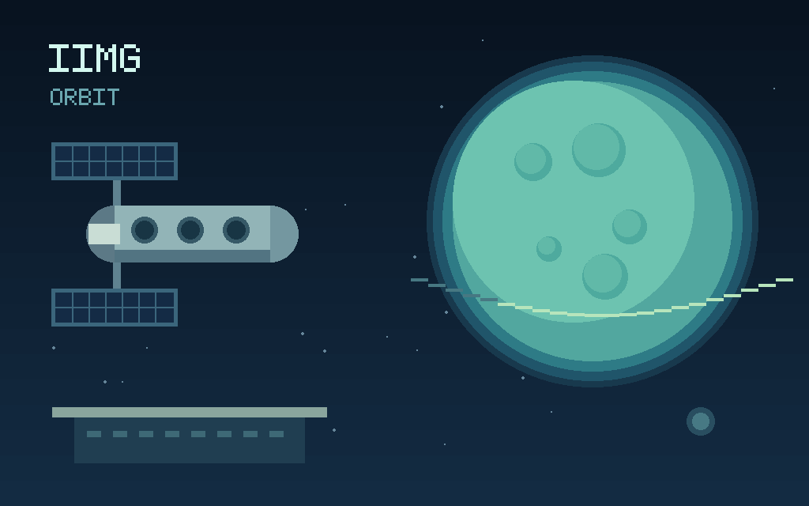
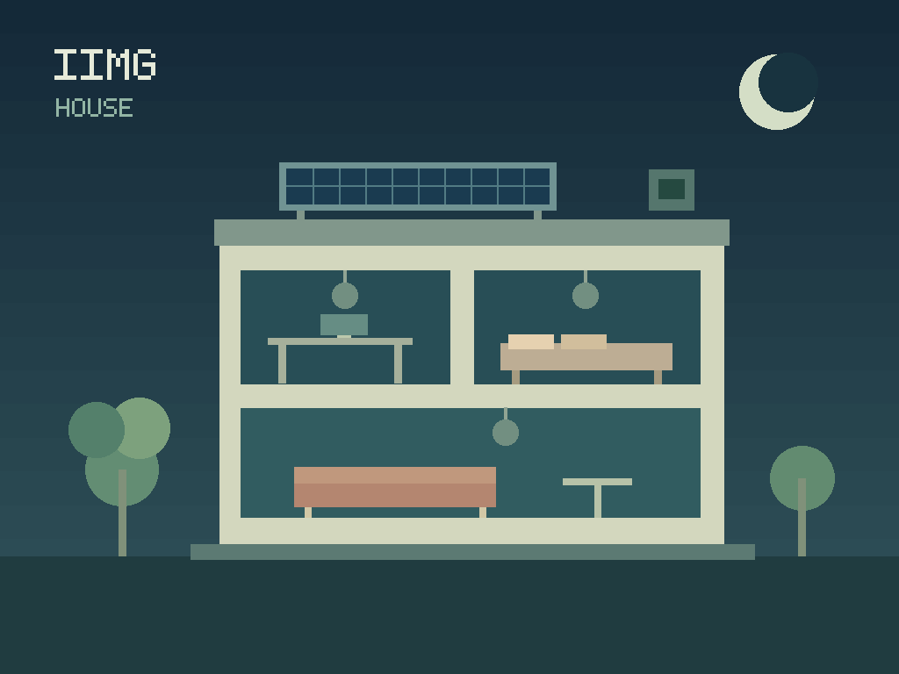
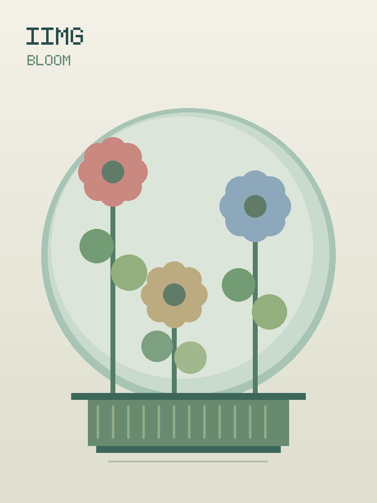

# IIMG showcase

Original rect/circle scenes authored for this project, with independent toggle controls and Arabic accessible labels. All artwork and the small letter geometry are project-authored; no external images, font files or scripts are embedded. Code and artwork use [Apache-2.0](../../LICENSES.md).

The PNGs below are static previews. Open the generated `.iimg` files in IIMG Viewer to interact with them. GitHub's image display does not run IIMG interactions.

| Scene | Canvas | Shapes | IIMG bytes | Controls |
| --- | --- | ---: | ---: | --- |
| Orbital night | 1024×640 | 170 | 49,518 | Three spacecraft windows and a station beacon |
| Solar house | 1024×768 | 114 | 37,815 | Three room lamps and a solar-energy indicator |
| Signal garden | 768×1024 | 114 | 41,444 | Three flower centers |







## Reproduce and edit

```sh
cargo build --locked -p iimg-cli
cargo build --locked --release --target wasm32-unknown-unknown -p iimg-web
python -B examples/showcase/generate.py --output target/showcase
node viewers/web/smoke-showcase.mjs target/showcase/manifest.json
```

The output directory must be new. Each scene has an editable `.source.json`, standalone `.iimg`, PNG preview and activation trace. The manifest records dimensions, object count, file digest, initial/active RGB digests and control coordinates/colors. Generation uses sorted letter runs and LF source text for reproducibility across hosts. The web source editor can import the generated source JSON.

Three additional grid workloads contain 256 shapes each at 256², 1024² and 2048² pixels. They measure scaling, not poster quality. The central tile is interactive. The native compiler validates each document; the Node smoke test compares complete native/WASM RGB digests and all 14 controls through pointer and keyboard activation and reset.

## Promotion and claims

These scenes demonstrate a self-contained offline interactive file with a bounded declarative renderer. Share the PNG when a static illustration is needed, and the IIMG when a recipient has the viewer. A file attachment opening in IIMG Viewer is distinct from native interactive display inside a messenger.

The current vector-only SVG/HTML equivalents are smaller than these IIMG files, whose mandatory PNG preview adds bytes. Use the [measured results](../../docs/BENCHMARKS.md) and their scope when discussing performance. These are original demonstrations, not evidence of universal application support or a completed external security audit.
